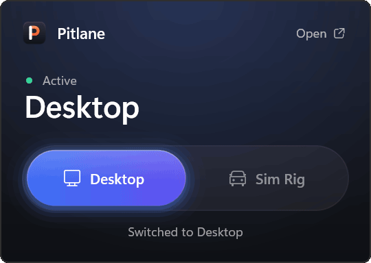
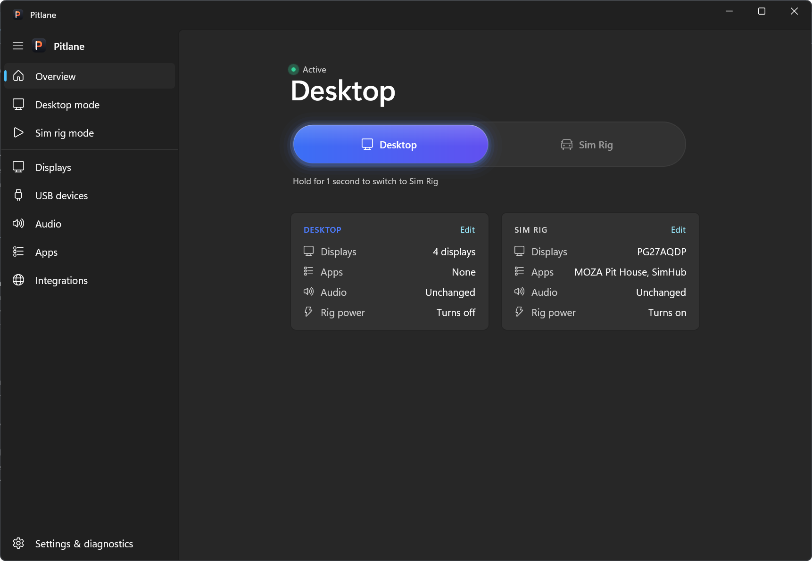
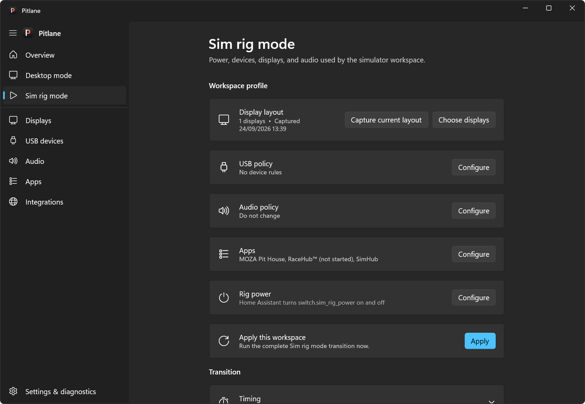
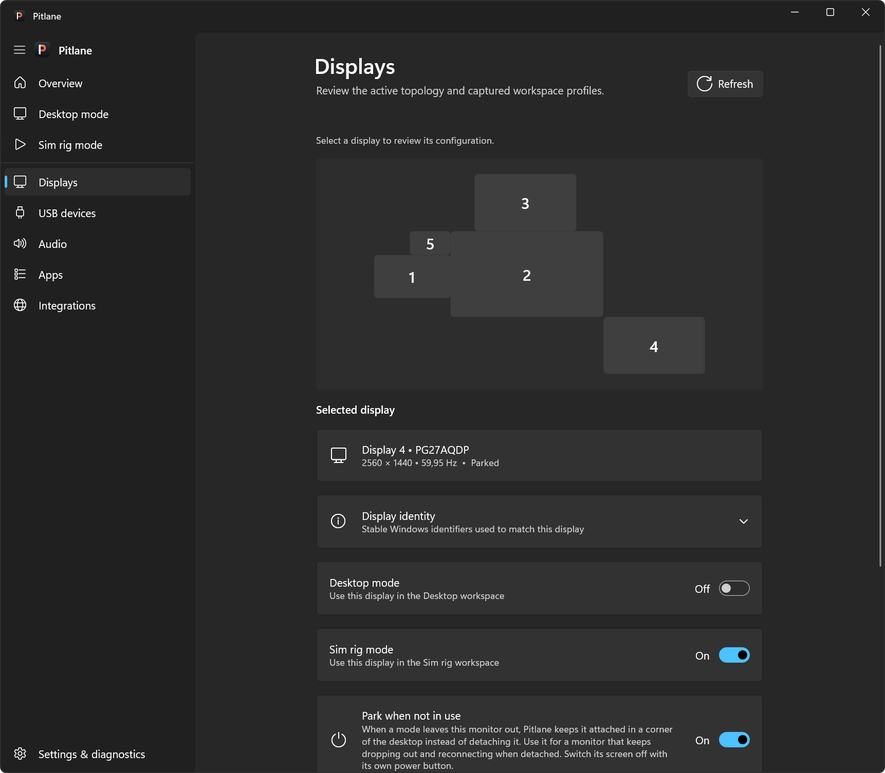
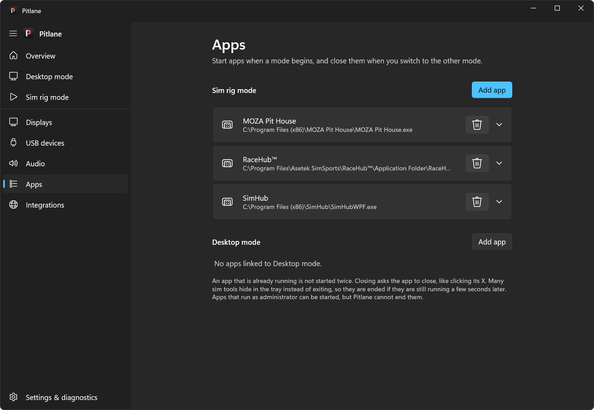
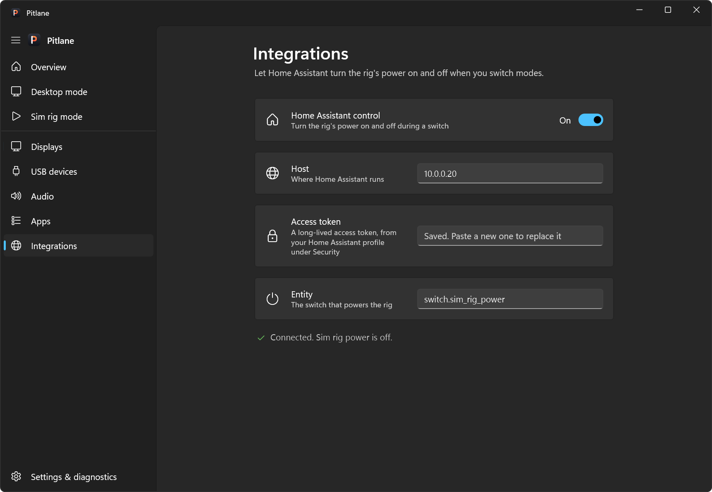
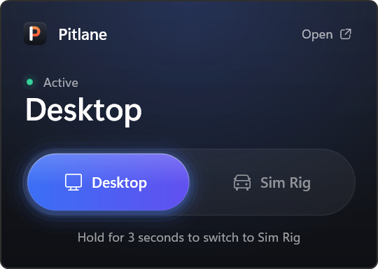
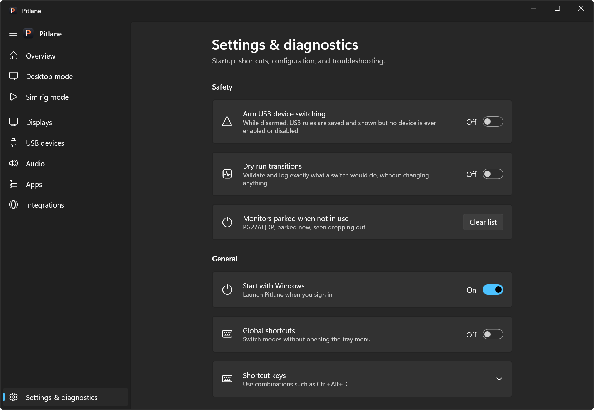

<p align="center">
  
</p>

<h1 align="center">Pitlane</h1>

<p align="center">
  <b>One switch between your desk and your sim rig.</b><br>
  A Windows tray app that moves your whole setup over with a single hold:<br>
  screens, sound, apps, USB devices and the rig's power.
</p>

<p align="center">
  
</p>

If one PC runs both your desk and your sim racing rig, every change of place means the same chores.
Screens go on and off, windows get lost on the wrong monitor, the sound comes out of the wrong
speakers, and SimHub and the wheel software need starting and closing again. Pitlane does all of that for you.
Click the tray icon, hold the switch for three seconds, and you are there.

## What it switches

- **Screens.** Each mode has its own layout: which screens are on, where they sit, and their
  resolution and refresh rate. After every switch Pitlane checks what Windows actually did, and
  puts the previous layout back if it did not come out as intended.
- **Apps.** Starts what a mode needs, like SimHub or your wheel software, and closes it again
  when you leave.
- **Sound.** Sets the default speakers and microphone for each mode.
- **USB devices.** Turns individual USB devices on or off per mode. It stays off until you arm
  it, and keyboards and mice are always protected.
- **Rig power.** Switches the rig's smart plug through Home Assistant.

## Screenshots

<p align="center">
  
  <br><sub>The main window: where you are, the same hold-to-switch toggle, and what each mode changes.</sub>
</p>

<table>
  <tr>
    <td width="50%" valign="top">
      
      <br><sub><b>A mode</b>, with its screens, USB devices, sound, apps and rig power in one place.</sub>
    </td>
    <td width="50%" valign="top">
      
      <br><sub><b>Displays</b>: every screen, the modes that use it, and parking for monitors that misbehave.</sub>
    </td>
  </tr>
  <tr>
    <td width="50%" valign="top">
      
      <br><sub><b>Apps</b> that start with a mode and close when you leave it.</sub>
    </td>
    <td width="50%" valign="top">
      
      <br><sub><b>Home Assistant</b>: an address, a token and the switch that powers the rig.</sub>
    </td>
  </tr>
  <tr>
    <td width="50%" valign="top">
      
      <br><sub><b>The tray flyout</b>, one click on the tray icon away.</sub>
    </td>
    <td width="50%" valign="top">
      
      <br><sub><b>Settings</b>: dry runs, Start with Windows, and keyboard shortcuts.</sub>
    </td>
  </tr>
</table>

## Getting started

### Requirements

- A 64-bit Windows 11 PC.
- Nothing else: the installer brings everything Pitlane needs.

### Install

1. Download **PitlaneSetup** from the [latest release](https://github.com/TheOriUHD/Pitlane/releases/latest).
2. Run it and choose where to install Pitlane. It installs for your user account, so it needs no
   administrator rights.
3. Pitlane starts in the notification area of the taskbar. To have it ready after every restart,
   right-click the tray icon and tick **Start with Windows**.

Windows may say the installer comes from an unknown publisher, because it is not code-signed. Click
**More info**, then **Run anyway**.

To update, run the newer setup; it replaces the installed version. To uninstall, use **Settings →
Apps → Installed apps**. Your settings stay in `%LOCALAPPDATA%\Pitlane`, in case you come back.

Prefer to build Pitlane yourself? See [Building from source](#building-from-source).

### Set up your two modes

1. **Desktop.** Arrange your desk screens in Windows' display settings. Open Pitlane (left-click
   the tray icon, then **Open**), go to **Desktop mode** and click **Capture current layout**.
2. **Sim Rig.** Arrange the screens the way you race, and capture the **Sim rig mode** layout the
   same way. You can also choose screens one by one on the **Displays** page.
3. **The extras, if you want them:**
   - **Apps**: add the apps each mode should start.
   - **Audio**: choose the default speakers and microphone for each mode.
   - **Integrations**: enter your Home Assistant address, a long-lived access token and the switch
     that powers the rig.
   - **USB devices**: choose what happens to each device in each mode, then arm USB switching under
     **Settings & diagnostics**.
4. **Try it safely.** Under **Settings & diagnostics**, turn on **Dry run transitions** and switch
   once: Pitlane checks everything and changes nothing. **Test switch without the displays**, under
   Advanced, does everything except the screens.

## Switching modes

- **Left-click the tray icon** and **hold the switch for three seconds**. Let go earlier and nothing
  happens. Space or Enter works too.
- **Right-click the tray icon** to switch straight away, to turn Start with Windows on or off, or
  to quit.
- **Keyboard shortcuts**: turn on **Global shortcuts** in Settings to switch with Ctrl+Alt+D
  (Desktop) and Ctrl+Alt+R (Sim Rig).
- The tray icon shows where you are: **blue** in Desktop mode, **orange** in Sim Rig mode.

During a switch Pitlane closes the apps of the mode you are leaving, sets up the screens and checks
them, then sets the sound, USB devices and rig power, and starts the new mode's apps. If the screens
do not come out as intended, it puts the previous layout back and tells you why.

## Good to know

<details>
<summary><b>A monitor keeps disconnecting when it is not in use, and the PC stutters</b></summary>
<br>

Some monitors, especially on HDMI, drop off and reconnect every few seconds once Windows stops
sending them a picture, and every reconnect makes the whole PC hitch. On the **Displays** page,
select that monitor and turn on **Park when not in use**. Pitlane then keeps it connected but shows
only black on it, in a corner the mouse does not reach, and moves any window that ends up there to
your main screen. Its power light stays on; switch it off with its own power button if you like.
When Pitlane sees a monitor dropping out again and again, it tells you.
</details>

<details>
<summary><b>DisplayLink screens and USB docks</b></summary>
<br>

Screens on DisplayLink, USB docks and virtual displays are left on or off as they are when you
switch. To have one follow your modes like any other screen, select it on the **Displays** page and
turn on **Switch with modes**.
</details>

<details>
<summary><b>Apps that run as administrator, or hide in the tray</b></summary>
<br>

Pitlane can start apps that run as administrator, but Windows does not let it close them. Apps
that hide in the tray instead of closing are ended after a few seconds, unless you turn that off
for them on the **Apps** page.
</details>

<details>
<summary><b>Where are my settings and logs?</b></summary>
<br>

In `%LOCALAPPDATA%\Pitlane`: the settings in `config.json`, and the last 14 days of logs under
`Logs`. **Settings & diagnostics** can export and import your configuration and open the logs.
</details>

## Privacy and safety

- Pitlane runs entirely on your PC. The only thing it ever contacts is your own Home Assistant, if
  you set it up.
- The Home Assistant token is encrypted for your Windows account. It is sent over plain http only
  to an address on your local network.
- Nothing changes unless you switch. In the background Pitlane only listens for the tray icon,
  your shortcuts and monitors dropping out. The one exception is a parked monitor, which it keeps
  black and clear of windows.
- Pitlane never touches Windows' own saved display settings and never sends commands to your
  monitors. It asks for administrator rights only to switch USB devices, once per switch.

The guarantees behind this, and the tests that hold the code to them, are in
[docs/SAFETY.md](docs/SAFETY.md).

## Building from source

For developers, and anyone who prefers to build Pitlane themselves. You need Windows and the
[.NET 8 SDK](https://dotnet.microsoft.com/download/dotnet/8.0).

```powershell
dotnet publish SimRigMode.csproj -c Release -r win-x64 --self-contained true -o dist
```

This produces `dist\Pitlane.exe`, a single file that runs from any folder. To build the installer
too, install [Inno Setup 6](https://jrsoftware.org/isinfo.php) and run its compiler on the script:

```powershell
iscc installer\Pitlane.iss
```

The setup lands in `dist\installer`. [docs/DEVELOPMENT.md](docs/DEVELOPMENT.md) covers the project
layout, the tests, releases and how the switching works under the hood.

---

<sub>Pitlane was called SimRigMode until September 2026, and the code still uses that name.</sub>
